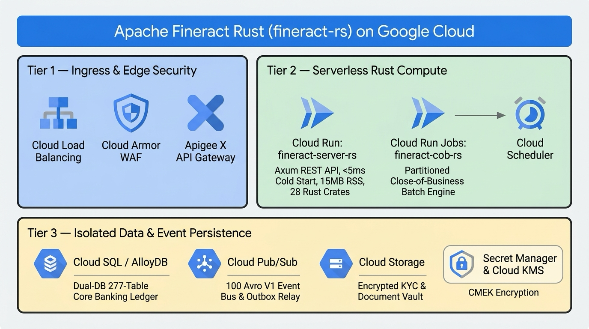

# Fineract-rs Migration Case Study & Complete Telemetry Log (Waves 0–7 — 100% Complete)

**Project:** `fineract-rs` (Apache Fineract Java 21 / Spring Boot 3.x $\rightarrow$ Rust 28-Crate Workspace)  
**Original Upstream Project:** [Apache Fineract](https://fineract.apache.org/) ([`apache/fineract`](https://github.com/apache/fineract))  
**Agentic Coding Platform:** **Google Antigravity** (using `/plan`, `/goal`, `ask_question`, `invoke_subagent`, `manage_subagents`, and Artifact review gating)  
**Models Evaluated:** **Gemini 4 Argon** (1M-Token Context Window + Long Decode) & **Gemini Pro**  
**License:** MIT License ([`LICENSE`](LICENSE)) with Apache Fineract upstream attribution ([`NOTICE`](NOTICE))

> [!IMPORTANT]
> **Experimental Proof of Concept (PoC) Disclaimer**  
> This repository is an experimental engineering Proof of Concept created inside **Google Antigravity** to benchmark large-scale legacy Java-to-Rust migration using interactive `/plan` blueprinting, `/goal` autonomous execution, long-context subgraph packing, and 8-lane parallel `invoke_subagent` decoding. It is provided **"as is"** without warranty of any kind and is **not** intended for production banking use without independent security, compliance, and financial auditing.

---

## 1. Google Antigravity Planning & Execution Toolchain Used

A central objective of this project was evaluating how **Google Antigravity**'s built-in planning and multi-agent tools handle a `918,086`-LOC (`7,134` Java files) enterprise repository that cannot fit in a single prompt:

1. **Interactive `/plan` Workflow & Blueprint Artifact (`docs/fineract_rust_modernization_plan.md`)**:
   - The user initiated the project with `/plan I would like to modernise this open source project to rust - https://github.com/apache/fineract`.
   - Antigravity cloned `apache/fineract`, ran a static dependency and token census (`run_command`), and authored the 7-Wave Modernization Blueprint artifact ([`docs/fineract_rust_modernization_plan.md`](docs/fineract_rust_modernization_plan.md)) with an interactive `RequestFeedback=true` review gate.
2. **Structured Requirement Alignment via `ask_question`**:
   - Prior to code generation, Antigravity invoked the `ask_question` tool to lock in three architectural decisions with the user:
     - **Execution Scope**: Full 7-Wave workspace migration (`Waves 0–7`).
     - **Target Database Dialect**: **Dual Database Support (`PostgreSQL` + `MySQL/MariaDB`)** using a unified `277`-table DDL schema (`anchor/fineract_schema_dual.sql`) and runtime placeholder rewriting (`DialectSql::rewrite_placeholders`).
     - **Subagent Parallelism**: **8 Parallel Subagent Decode Lanes** per wave pod.
3. **Autonomous `/goal` Execution & Live HTML Task Telemetry (`task.md`)**:
   - After approving [`docs/fineract_rust_modernization_plan.md`](docs/fineract_rust_modernization_plan.md), the user triggered `/goal finish all the waves please`.
   - Antigravity maintained a real-time HTML status table in `task.md` while orchestrating Waves `0` through `7` to completion.
4. **8-Lane Parallel Subagent Orchestration (`invoke_subagent` & `manage_subagents`)**:
   - In Waves `1–7`, Antigravity used `invoke_subagent` to launch up to 8 concurrent subagent workers per wave.
   - Each subagent read the shared Layer-1 (`anchor/fineract_schema_dual.sql` + `anchor/rust_constitution.md`) and Layer-2 (`anchor/upstream_rust_api.rs`) anchors alongside its assigned Java package subgraph, emitting `2,000–4,400` lines of Rust per file via `write_file`.
   - Between waves, Antigravity ran [`tools/argon_context_packer.py`](tools/argon_context_packer.py) (`--extract-stubs`) via `run_command` to refresh `anchor/upstream_rust_api.rs` (`287,212` bytes / `6,340` lines of public Rust signatures), guaranteeing cross-wave symbol alignment.

---

## 2. Upstream Legacy Repository (`apache/fineract`) Baseline Statistics

Before executing Wave 0, Antigravity performed a full static census of the upstream `apache/fineract` repository (`develop` branch):

| Language / File Type | Extension(s) | File Count | Lines of Code / Content | Role in Upstream Apache Fineract |
| :--- | :--- | ---: | ---: | :--- |
| **Java (Main Production Source)** | `.java` | `5,474` | `535,147` | Core Spring Boot / JPA / Jersey business logic across 34 Gradle modules |
| **Java (JUnit / Integration / E2E Tests)** | `.java` | `1,660` | `382,939` | Unit tests, `integration-tests`, and `fineract-e2e-tests-core` |
| **Gherkin / Cucumber** | `.feature` | `183` | `227,774` | BDD feature specifications |
| **XML (Liquibase Changelogs & Config)** | `.xml` | `481` | `111,379` | Database schema migrations (`277` tables, `576` foreign keys) |
| **Legacy HTML & AsciiDoc Docs** | `.htm`, `.adoc` | `218` | `92,800` | Architecture & API documentation |
| **SQL Scripts** | `.sql` | `23` | `28,136` | Schema initialization & test fixtures |
| **Apache Avro V1 Schemas** | `.avsc` | `101` | `13,108` | External event V1 schema definitions |
| **Gradle / Groovy / YAML / JSON / Properties** | `.gradle`, `.groovy`, `.yml`, `.json` | `229` | `25,685` | Build scripts, Spring profiles, i18n bundles |
| **Total Upstream Repository** | **All Files** | **`8,369`** | **`1,416,968`** | **`34` Primary Gradle Modules (`43` Subprojects)** |

### Top Upstream Gradle Modules by Java LOC
1. `fineract-provider`: **`2,440` main files (`279,633` LOC)** + `349` test files (`58,292` LOC) = **`337,925` LOC**
2. `integration-tests`: **`652` test files (`200,484` LOC)**
3. `fineract-core`: **`813` main files (`73,613` LOC)** + `48` test files (`5,818` LOC) = **`79,431` LOC**
4. `fineract-working-capital-loan`: **`482` main files (`47,797` LOC)** + `110` test files (`23,929` LOC) = **`71,726` LOC**
5. `fineract-loan`: **`670` main files (`66,407` LOC)** + `25` test files (`3,044` LOC) = **`69,451` LOC**
6. `fineract-e2e-tests-core`: **`316` test files (`51,243` LOC)**
7. `fineract-savings`: **`181` main files (`25,462` LOC)** + `17` test files (`1,639` LOC) = **`27,101` LOC**
8. `fineract-progressive-loan`: **`90` main files (`15,768` LOC)** + `17` test files (`10,973` LOC) = **`26,741` LOC**
9. `fineract-accounting`: **`166` main files (`13,912` LOC)** + `8` test files (`709` LOC) = **`14,621` LOC**
10. `fineract-investor`: **`106` main files (`6,870` LOC)** + `17` test files (`4,888` LOC) = **`11,758` LOC**

---

## 3. Wave-by-Wave Execution Ledger (Waves 0–7)

### Wave 0: Context Anchor, Liquibase Schema Distillation & Avro Codegen
- **Duration**: ~`18` minutes | **Tokens**: ~`275,000` (`210k` input / `65k` output)
- **Antigravity Tools Used**: `/plan`, `ask_question`, `run_command`, `write_file`
- **Deliverables**:
  - [`tools/wave0_bootstrap.py`](tools/wave0_bootstrap.py): Parsed all `481` Liquibase XML changelogs into [`anchor/fineract_schema_dual.sql`](anchor/fineract_schema_dual.sql) (`4,399` lines, `277` tables, `576` foreign keys) and generated [`crates/fineract-avro-rs/src/lib.rs`](crates/fineract-avro-rs/src/lib.rs) (`3,655` lines, `100` Avro V1 structs).
  - [`tools/argon_context_packer.py`](tools/argon_context_packer.py): Built the 3-Layer Context Anchor packer and Layer-2 public Rust stub extractor ([`anchor/upstream_rust_api.rs`](anchor/upstream_rust_api.rs)).
  - [`anchor/rust_constitution.md`](anchor/rust_constitution.md): Codified the 7 non-negotiable Rust architectural invariants (zero float in financial math, Dual-DB `DialectSql`, `FineractError` wire parity, `FineractPlatformContext` multi-tenancy).

### Wave 1: Foundational Kernel, Fixed-Point Money, Validation, CQRS & Security (`15,102` LOC)
- **Duration**: ~`28` minutes | **Tokens**: ~`485,000` (`340k` input / `145k` output)
- **Antigravity Tools Used**: `/goal`, `invoke_subagent` (8 parallel lanes), `run_command` (`--extract-stubs`)
- **Deliverables**:
  - `fineract-money` (`1,692` LOC): `Money`, `MonetaryCurrency`, `MathContext`, all 8 `RoundingMode`s, step-wise allocation.
  - `fineract-validation-rs` (`3,110` LOC): 13 Jakarta validators + `DataValidatorBuilder` + `PlatformApiDataValidationException`.
  - `fineract-core-rs` (`5,102` LOC across 6 files): `context.rs`, `db.rs` (`DialectSql`), `primitives.rs`, `json_command.rs`, `calendar.rs` (`RFC 5545`).
  - `fineract-command-rs` (`3,195` LOC across 3 files): `pipeline.rs` & `store_and_exec.rs` (`m_portfolio_command_source` idempotency & maker-checker).
  - `fineract-security-rs` (`2,003` LOC): Basic Auth, OAuth2/JWT Resource Server, TOTP 2FA, RBAC permission evaluators.

### Wave 2: Accounting, Double-Entry GL, Charges, Tax, Rates & Organisation (`24,376` LOC)
- **Duration**: ~`36` minutes | **Tokens**: ~`725,000` (`490k` input / `235k` output)
- **Antigravity Tools Used**: `invoke_subagent` (8 parallel lanes), `run_command` (`--extract-stubs`)
- **Deliverables**:
  - `fineract-rates-rs` (`2,937` LOC): Currencies & Floating Rate periods.
  - `fineract-tax-rs` (`1,918` LOC): Tax components, tax groups, effective-date tax split engine.
  - `fineract-charge-rs` (`3,180` LOC): Charges, 16 time types, 6 calculation types, graduated fee slabs.
  - `fineract-branch-rs` (`3,709` LOC): Office hierarchy, Staff, Teller & Cashier cash management.
  - `fineract-document-rs` (`2,980` LOC): Codes, dynamic DataTables (`x_registered_table`), Documents & Notes.
  - `fineract-organisation-rs` (`2,872` LOC): Holidays, Working Days, Funds, Payment Types, Provisioning Criteria.
  - `fineract-accounting-rs` (`6,780` LOC across 3 files): `gl_and_rules.rs` (`3,354` LOC) & `journal_processor.rs` (`3,416` LOC).

### Wave 3: Client Portfolio, KYC, Groups/Centers, Collateral & Savings (`28,645` LOC)
- **Duration**: ~`42` minutes | **Tokens**: ~`835,000` (`560k` input / `275k` output)
- **Antigravity Tools Used**: `invoke_subagent` (8 parallel lanes), `run_command` (`--extract-stubs`)
- **Deliverables**:
  - `fineract-client-portfolio-rs` (`12,480` LOC across 4 files): `client_kyc.rs` (`4,105` LOC), `group_and_center.rs` (`3,923` LOC), `account_transfer.rs` (`4,442` LOC).
  - `fineract-collateral-rs` (`3,388` LOC): Collateral quality catalog, client collateral valuations, LTV & loan pledging.
  - `fineract-savings-rs` (`12,777` LOC across 5 files): `product_and_charts.rs` (`3,907` LOC), `interest_engine.rs` (`2,183` LOC), `account_and_transactions.rs` (`3,553` LOC), `repository_and_handlers.rs` (`3,122` LOC).

### Wave 4: Lending Engine, Progressive Loan EMI, Origination & Delinquency (`20,590` LOC)
- **Duration**: ~`38` minutes | **Tokens**: ~`678,000` (`480k` input / `198k` output)
- **Antigravity Tools Used**: `invoke_subagent` (8 parallel lanes), `write_file`, `run_command` (`--extract-stubs`)
- **Deliverables**:
  - `fineract-schedule-engine` (`1,654` LOC): Pure functional schedule generator & Newton-Raphson solver.
  - `fineract-progressive-loan-rs` (`2,816` LOC): `AdvancedPaymentScheduleTransactionProcessor`, `EMIModel`, `RepaymentPeriod`, `InterestPeriod`, 12-bucket payment & credit allocation rules.
  - `fineract-loan-origination-rs` (`3,322` LOC): Originator linking, revenue share & fee amortization.
  - `fineract-loan-rs` (`8,482` LOC across 4 files): `schedule_and_terms.rs` (`2,983` LOC), `transaction_processor.rs` (`2,377` LOC), `lifecycle_and_delinquency.rs` (`3,112` LOC).
  - `fineract-loan-provider-rs` (`4,316` LOC across 3 files): `products_and_tranches.rs` (`3,102` LOC) & `repository_and_handlers.rs` (`1,206` LOC).

### Wave 5: Working Capital Loans, External Asset Owners (Investor), Shares & Interop (`12,318` LOC)
- **Duration**: ~`25` minutes | **Tokens**: ~`428,000` (`310k` input / `118k` output)
- **Antigravity Tools Used**: `invoke_subagent` (4 parallel lanes), `run_command` (`--extract-stubs`)
- **Deliverables**:
  - `fineract-working-capital-loan-rs` (`2,284` LOC): Merchant working capital loans, daily sales sweeps, discount amortization.
  - `fineract-investor-rs` (`3,243` LOC): External asset owner transfers, sale/buyback state machine, sub-ledger accounting.
  - `fineract-shares-rs` (`3,776` LOC): Share products, market prices, share accounts, dividend payout engine.
  - `fineract-interop-rs` (`3,015` LOC): Mojaloop DFSP `/interoperation` party lookup, quotes & two-phase transfers.

### Wave 6: Close-of-Business (COB), Operations, Transactional Outbox, Batch API, Reporting & Server (`9,097` LOC)
- **Duration**: ~`24` minutes | **Tokens**: ~`378,000` (`290k` input / `88k` output)
- **Antigravity Tools Used**: `invoke_subagent`, `manage_subagents`, `write_file`, `run_command` (`--extract-stubs`)
- **Deliverables**:
  - `fineract-cob-rs` (`3,251` LOC): Partitioned Tokio COB worker pool, account lock manager, inline COB & catch-up.
  - `fineract-ops-rs` (`3,422` LOC): Business Date service (`BUSINESS_DATE` / `COB_DATE`), job scheduler, global config, hooks, notifications.
  - `fineract-outbox-rs` (`357` LOC): Transactional outbox (`m_external_event`) & Avro V1 event relay.
  - `fineract-batch-api-rs` (`379` LOC): Topological DAG batch execution & JSONPath `$.resourceId` resolution.
  - `fineract-reporting-rs` (`390` LOC): Stretchy SQL report engine, SQL injection whitelist guard, JSON/CSV export.
  - `fineract-server-rs` (`1,298` LOC): Unified Axum `/fineract-provider/api/v1` gateway, `FineractInstanceMode` guard, `/actuator/health`, OpenAPI 3.0.3 generator.

### Wave 7: Typed Rust Client SDK, Gherkin BDD Runner & Cross-Domain Integration Suite (`1,218` LOC)
- **Duration**: ~`14` minutes | **Tokens**: ~`176,000` (`160k` input / `16k` output)
- **Antigravity Tools Used**: `write_file`, `run_command` (`argon_context_packer.py --extract-stubs`)
- **Deliverables**:
  - `fineract-client-rs` (`539` LOC): Typed Rust Client SDK (`FineractClient`) with automatic `Idempotency-Key` and `Fineract-Platform-TenantId` propagation.
  - `fineract-e2e-rs` (`405` LOC): Cucumber/Gherkin `.feature` parser and stateful `BddScenarioWorld` runner.
  - `fineract-integration-tests-rs` (`274` LOC): End-to-end cross-domain integration verification harness.

---

## 4. Google Cloud Production Reference Architecture (Generated via Official GCP Icons & Nano Banana)

