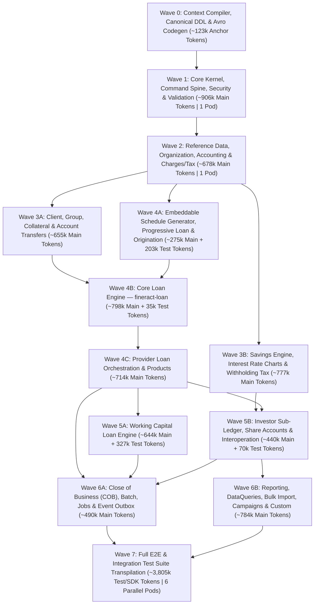

# Apache Fineract → Rust Full-Codebase Wave Migration Plan (Powered by Gemini 4 Argon)

> [!IMPORTANT]
> **Why Gemini 4 Argon Transforms This Migration**
> Traditional LLM migrations fail on large Java monoliths because translating **file-by-file** blinds the model to cross-module invariants, bidirectional JPA entity graphs, and database column types—resulting in uncompilable Rust borrow-checker tangles.
>
> By exploiting **Gemini 4 Argon's Long Context** and **High-Throughput Structured Decode**, we eliminate file-by-file translation entirely. Instead, we pack **entire closed dependency subgraphs (450k–850k tokens per Argon Pod)** alongside the **complete SQL DDL and Avro schemas** into a single context window, and use **Two-Stage Long Decode** to emit entire compilable Rust crates in topological waves.

---

## 1. Empirical Repository Telemetry (`apache/fineract` @ `develop`)

An exact audit of the upstream repository (`11,305` git tree objects) establishes the total token volume to be migrated across all **34 Gradle modules**:

| Codebase Category | File Count | Raw Size (Bytes) | Approx. Token Count | Context Strategy in Gemini 4 Argon |
| :--- | ---: | ---: | ---: | :--- |
| **Production Java (`src/main/java`)** | `5,474` | `28,031,903` | **`~7,007,975`** | Partitioned into **11 Long-Context Domain Pods** across Waves 1–6 (`450k–820k` tokens/pod). |
| **Test Java (`src/test/java`)** | `1,660` | `21,194,230` | **`~5,298,557`** | Module unit tests co-loaded in Waves 1–6; `integration-tests` (`2.86M` tok) & `e2e` (`900k` tok) migrated in Wave 7. |
| **Avro Event Schemas (`.avsc`)** | `101` | `310,138` | **`~77,534`** | **100% pinned** in the Frozen Anchor Prefix of every wave. |
| **Liquibase Changelogs (`.xml`)** | `481` | `6,137,294` | `~1,534,323` → **`~45,000` (DDL)** | Materialized once in Wave 0 into canonical PostgreSQL `schema.sql` (`~45k` tokens) and **100% pinned** in every wave. |
| **Total Repository Scope** | **`7,716`** | **`55,673,565`** | **`~13,918,389`** | **100% of production, schema, event, and test code covered in 7 Waves.** |

---

## 2. Gemini 4 Argon Long-Context & Decode Mechanics

### 2.1 The 3-Layer Context Window Layout (Per Wave Pod)

Every Gemini 4 Argon invocation is structured to maximize **Prefix Cache Reuse** across parallel decode workers:

```mermaid
flowchart LR
    subgraph L1["Layer 1: Frozen Global Anchor (~135k Tokens — 100% Prefix Cached)"]
        DDL["Canonical Tenant & Metadata SQL DDL (~45k tok)"]
        AVRO["All 101 Fineract Avro .avsc Schemas (~77.5k tok)"]
        RULES["Rust Idiom & Financial Math Constitution (~12.5k tok)"]
    end

    subgraph L2["Layer 2: Cumulative Upstream Rust API Header (~15k–60k Tokens)"]
        STUBS["Public .rs Trait/Struct/Error Signatures from Waves 1..N-1 (cargo public-api)"]
    end

    subgraph L3["Layer 3: Active Wave Domain Subgraph (~450k–820k Tokens)"]
        JAVA_MAIN["100% of src/main/java for Target Module(s)"]
        JAVA_TEST["100% of src/test/java Unit Tests for Target Module(s)"]
    end

    L1 --> L2 --> L3 --> DECODE["Gemini 4 Argon Two-Stage Decode Engine"]
```

1. **Layer 1: Frozen Global Anchor (`~135k` tokens, invariant across all waves)**
   - **Canonical SQL Schema (`~45k` tokens)**: Instead of feeding `1.53M` tokens of verbose Liquibase XML diffs, Wave 0 boots a Testcontainers PostgreSQL instance, runs Liquibase to completion, and dumps `pg_dump --schema-only`. Every wave sees the exact tables, column types, foreign keys, and indexes.
   - **All 101 Avro Schemas (`~77.5k` tokens)**: Ensures every domain event emitted to `m_external_event` matches upstream `fineract-avro-schemas` field-for-field.
   - **Rust Architecture Constitution (`~12.5k` tokens)**: Enforces `FineractDecimal` rounding rules, `sqlx` query patterns, `FromFineractJson` locale/dateFormat parsing, and explicit `DomainDelta` persistence (replacing EclipseLink dirty-checking).
2. **Layer 2: Cumulative Upstream Rust API Header (`~15k–60k` tokens)**
   - Generated automatically after each wave completes by stripping function bodies from already-migrated Rust crates (keeping only `pub struct`, `pub enum`, `pub trait`, and `pub fn` signatures). This gives Wave $N$ exact compile-time type signatures for Waves $1 \dots N-1$ at <5% of their full token cost.
3. **Layer 3: Active Wave Domain Subgraph (`~450k–820k` tokens)**
   - The complete, untruncated Java source and unit tests of the target Gradle module(s) and corresponding `fineract-provider` packages.

### 2.2 The Two-Stage High-Throughput Decode Pipeline

To prevent cross-file drift when generating 30,000–80,000 lines of Rust per wave, each Wave Pod executes **two distinct decode stages** against the cached long-context prefix:

- **Decode Stage A — Whole-Crate Skeleton & Type Contract (`1` Argon Call per Pod)**:
  - With the entire 700k-token Java subgraph in context, Gemini 4 Argon decodes a single exhaustive **Crate Contract Manifest** (`lib.rs`, `domain/models.rs`, `domain/traits.rs`, `error.rs`, `repo/rows.rs`, and OpenAPI DTO structs) containing **all public types, database row structs, state enums, and function signatures with `todo!()` bodies**.
  - **Gate A**: `cargo check` runs immediately on the skeleton crate. Once `cargo check` passes (0 type/import errors across the crate boundary), the contract is locked and appended to the cached context prefix.
- **Decode Stage B — Parallel Multi-File Implementation & Test Decode (`4–8` Concurrent Subagent Lanes per Pod)**:
  - Multiple parallel Gemini 4 Argon decode workers attach to the locked `[Layer 1 + Layer 2 + Layer 3 + Locked Crate Skeleton]` prefix cache.
  - Each worker is assigned a disjoint slice of module files (e.g., Worker 1: `repo/*.rs` SQLx queries; Worker 2: `service/write/*.rs` command handlers; Worker 3: `service/read/*.rs` query handlers; Worker 4: `tests/*.rs` unit tests) and utilizes Argon's long decode capacity to emit complete, production-ready Rust files in one continuous stream.
  - **Gate B (Compiler-in-the-Loop Repair)**: An automated loop runs `cargo test --package <crate>` + `sqlx prepare --check`, feeding any rustc borrow-checker or type diagnostics back into the same long-context session until 100% of unit tests compile and pass.

---

## 3. Master Topological Wave Schedule (Waves 0–7)

---

## 4. Detailed Wave-by-Wave Breakdown & Context Manifests

### Wave 0: Context Compiler, Canonical DDL & Avro Codegen (Day 1–3)
- **Objective**: Build the deterministic tooling that feeds Gemini 4 Argon across Waves 1–7 and initialize the Cargo workspace.
- **Inputs**:
  - `fineract-avro-schemas` (`101` `.avsc` files, `77.5k` tokens)
  - `fineract-provider/src/main/resources/db/changelog` (`481` XML files, `1.53M` tokens)
- **Execution**:
  1. Run Liquibase against an ephemeral PostgreSQL 16 container (`fineract_tenants` + `fineract_default`) and export `anchor/fineract_schema.sql` (`~45k` tokens).
  2. Generate the `fineract-avro-rs` crate from all 101 `.avsc` files using `apache-avro` build scripts.
  3. Build `tools/argon-context-packer`, a small Rust utility that packages `[Layer 1 Anchor + Layer 2 Rust API Stubs + Layer 3 Target Java Files]` into a single prompt context and unpacks multi-file Rust decode blocks (`// === FILE: crates/... ===`).

---

### Wave 1: Core Kernel, Command Spine, Security & Validation
- **Target Rust Crates**: `fineract-money`, `fineract-core-rs`, `fineract-validation-rs`, `fineract-command-rs`, `fineract-security-rs`
- **Argon Context Pod Size**: **1 Pod** (`~906k` Main Java tokens + `~86k` Test tokens + `~135k` Anchor = **`~1.12M` total context tokens**, or split into `Pod 1A: Core & Money` [`~650k` tok] and `Pod 1B: Command, Security & Infra` [`~480k` tok])
- **Exact Source Modules Packed in Context**:
  - `fineract-core` (`813` main files / `783.3k` tok + `48` test files / `63.7k` tok)
  - `fineract-validation` (`8` main files / `3.7k` tok + `3` test files / `2.8k` tok)
  - `fineract-command`, `fineract-command-jdbc`, `fineract-command-audit`, `fineract-command-async`, `fineract-command-disruptor`, `fineract-command-test` (`77` main files / `28.8k` tok + `8` test files / `6.7k` tok)
  - `fineract-security` + `oauth2-tests` + `twofactor-tests` (`65` main files / `47.6k` tok + `8` test files / `16.0k` tok)
  - `fineract-provider/infrastructure/{core, security, configuration, cache, entityaccess}` (`~150` main files / `~126k` tok)
- **Key Deliverables Decoded**:
  - `FineractMoney`, `MonetaryCurrency`, `MathContext`, and rounding modes (`rust_decimal`).
  - Locale-aware `FromFineractJson` deserializer handling dynamic `locale` and `dateFormat` attributes.
  - Multi-tenant `sqlx::PgPool` router (`Fineract-Platform-TenantId`) and `BusinessDateContext` (`BUSINESS_DATE`, `COB_DATE`).
  - Typed CQRS Command Pipeline (`m_portfolio_command_source`), Idempotency middleware, Maker-Checker workflow, and Ring-Buffer/MPSC dispatcher.
  - Spring Security / OAuth2 Resource Server / Basic Auth / 2FA filters translated to `axum` + `tower` extractors.

---

### Wave 2: Reference Data, Organization, Accounting & Charges/Tax
- **Target Rust Crates**: `fineract-rates-rs`, `fineract-tax-rs`, `fineract-charge-rs`, `fineract-branch-rs`, `fineract-document-rs`, `fineract-organisation-rs`, `fineract-accounting-rs`
- **Argon Context Pod Size**: **1 Pod** (`~678k` Main Java tokens + `~35k` Test tokens + `~155k` Anchor/Stubs = **`~868k` total context tokens**)
- **Exact Source Modules Packed in Context**:
  - `fineract-rates` (`29` files / `22.5k` tok), `fineract-tax` (`29` files / `28.1k` tok), `fineract-charge` (`37` files / `43.7k` tok)
  - `fineract-branch` (`41` files / `37.1k` tok), `fineract-document` (`80` files / `48.5k` tok)
  - `fineract-accounting` (`166` files / `171.7k` tok) + `fineract-provider/accounting` (`42` files / `154.7k` tok)
  - `fineract-provider/organisation/{holiday, monetary, office, staff, teller, workingdays, provisioning}` + `fineract-provider/useradministration` (`141` files / `~172k` tok)
- **Key Deliverables Decoded**:
  - Full Double-Entry General Ledger (`m_acc_gl_account`, `m_acc_gl_journal_entry`), Cash vs. Periodic/Upfront Accrual processor, Financial Activity Accounts, Closing Entries, and Provisioning Entries.
  - Holiday & Working-Days rescheduling rules (`ical4j` recurrence rules translated to `rrule`), Offices, Staff, Teller cash management, Roles/Permissions, Tax groups/components, and Fee/Penalty Charge definitions.

---

### Wave 3: Client, Group, Collateral, Account Transfers & Savings Engine
- **Target Rust Crates**: `fineract-client-portfolio-rs`, `fineract-collateral-rs`, `fineract-savings-rs`
- **Argon Context Pod Size**: **2 Parallel Pods** (executed concurrently since both depend only on Waves 1–2):
  - **Pod 3A (`fineract-client-portfolio-rs` & `fineract-collateral-rs` — `~655k` Main Tokens)**:
    - `fineract-provider/portfolio/{client, group, address, meeting, calendar, collateral, collateralmanagement, account, accountdetails, paymentdetail, fund, note}` (`440` files / `~655k` tok)
    - Emits Client/Group/Center KYC lifecycle, JLG calendar meetings, Standing Instructions, Account Transfers (`m_account_transfer_transaction`), and Collateral Management.
  - **Pod 3B (`fineract-savings-rs` — `~777k` Main Tokens)**:
    - `fineract-savings` (`181` files / `325.8k` tok + `17` test files / `20.0k` tok)
    - `fineract-provider/portfolio/{savings, interestratechart}` (`215` files / `494.8k` tok)
    - Emits Savings Products, Deposit/Withdrawal/Overdraft state machines, Fixed Deposit & Recurring Deposit interest rate charts, daily compounding, interest posting,lien/hold amounts, and dormancy tracking.

---

### Wave 4: The Core Loan Engine (Schedules, Progressive, Cumulative & Origination)
- **Target Rust Crates**: `fineract-schedule-engine`, `fineract-progressive-loan-rs`, `fineract-loan-origination-rs`, `fineract-loan-rs`
- **Argon Context Pod Size**: **3 Coordinated Pods** (sized so each pod fits 100% of its mathematical & state-machine classes in a single Argon window):
  - **Pod 4A — Pure Schedule & Progressive Math (`~275k` Main + `~203k` Test Tokens = `~478k` Tokens)**:
    - `fineract-progressive-loan-embeddable-schedule-generator` (`1` main file / `1.0k` tok + `2` test files / `4.6k` tok)
    - `fineract-progressive-loan` (`90` main files / `225.3k` tok + `17` test files / `180.4k` tok)
    - `fineract-loan-origination` (`58` main files / `48.8k` tok + `10` test files / `18.0k` tok)
    - **Why Co-Packed**: Packing all `180.4k` tokens of progressive loan unit tests alongside the `225.3k` tokens of implementation allows Gemini 4 Argon to decode both the pure Rust EMI/Progressive calculator AND all parameterized test vectors in one shot.
  - **Pod 4B — Core Loan Domain (`fineract-loan` — `~798k` Main + `~35k` Test Tokens = `~833k` Tokens)**:
    - `fineract-loan` (`670` main files / `797.6k` tok + `25` test files / `35.2k` tok)
    - Emits Loan Transaction Processor strategies (Standard, Advanced Payment Allocation, Early Repayment, Heavensfamily, Creocore), delinquency bucket classification, interest recalculation, reschedule/restructure, charge-off, and backdated transaction replay.
  - **Pod 4C — Provider Loan Orchestration & Products (`~714k` Main Tokens)**:
    - `fineract-provider/portfolio/{loanaccount, loanproduct}` (`170` files / `713.8k` tok)
    - Emits Loan Application submittal/approval/disbursement write services, multi-tranche disbursement, guarantor/collateral hooks, and `sqlx` read/write repositories replacing `Loan.java` EclipseLink entity cascades.

---

### Wave 5: Working Capital Loans, Investor Sub-Ledger, Shares & Interoperation
- **Target Rust Crates**: `fineract-working-capital-loan-rs`, `fineract-investor-rs`, `fineract-shares-rs`, `fineract-interop-rs`
- **Argon Context Pod Size**: **2 Parallel Pods**:
  - **Pod 5A — Working Capital Loan Engine (`~644k` Main + `~327k` Test Tokens = `~971k` Tokens)**:
    - `fineract-working-capital-loan` (`482` main files / `644.2k` tok + `110` test files / `326.8k` tok)
    - Self-contained Gradle module in Fineract; fits completely (implementation + all 110 test files) inside a single Argon context window for 1:1 translation into `fineract-working-capital-loan-rs`.
  - **Pod 5B — Investor Sub-Ledger, Share Accounts & Mojaloop Interop (`~440k` Main + `~70k` Test Tokens = `~510k` Tokens)**:
    - `fineract-investor` (`106` main files / `85.2k` tok + `17` test files / `70.3k` tok)
    - `fineract-provider/portfolio/{shareaccounts, shareproducts, transfer, delinquency, rate, floatingrates, coapplicant}` (`~190` files / `~307k` tok)
    - `fineract-provider/interoperation` (`44` files / `47.7k` tok)

---

### Wave 6: Close of Business (COB), Batch, Event Outbox, Reporting & Operations
- **Target Rust Crates**: `fineract-cob-rs`, `fineract-outbox-rs`, `fineract-batch-api-rs`, `fineract-reporting-rs`, `fineract-ops-rs`
- **Argon Context Pod Size**: **2 Parallel Pods**:
  - **Pod 6A — COB Engine, Batch API, Jobs & Event Outbox (`~490k` Main Tokens)**:
    - `fineract-cob` (`67` files / `35.0k` tok) + `fineract-provider/cob` (`80` files / `58.2k` tok)
    - `fineract-provider/batch` (`52` files / `47.7k` tok — JSON Batch API with relative JSONPath `$.resourceId` resolution)
    - `fineract-provider/infrastructure/{event, jobs, springbatch, hooks, sms, campaigns}` (`402` files / `348.7k` tok)
    - Emits the lock-free `SELECT ... FOR UPDATE SKIP LOCKED` Rust COB worker pool, Inline COB interceptor, Quartz-equivalent cron scheduler (`tokio-cron-scheduler`), and Kafka/AMQP transactional Avro outbox relay.
  - **Pod 6B — Reporting, DataTables, Bulk Import & Custom Extensions (`~784k` Main Tokens)**:
    - `fineract-report` (`6` files / `3.2k` tok)
    - `fineract-provider/infrastructure/{dataqueries, bulkimport, reportmailingjob, creditbureau, survey, documentmanagement, codes, gcm}` + `spm` + `template` + `notification` + `adhocquery` + `portfolio/collectionsheet` + `custom` (`824` files / `~781k` tok)
    - Emits Dynamic DataTables (`x_registered_table` DDL/DML inspector), Excel/CSV Bulk Import (`calamine` + `rust_xlsxwriter` replacing Apache POI), Mustache/Tera templates, and Wasm/Trait plugin hooks for `:custom`.

---

### Wave 7: Full-Codebase Test & Client SDK Migration (`1,660` Test Files)
- **Objective**: Migrate 100% of Fineract's massive black-box integration and E2E test suites so `fineract-rs` is validated both by upstream Java tests over HTTP and by native Rust integration tests.
- **Argon Context Pod Size**: **6 Parallel Decode Pods** (`~630k–750k` tokens per pod):
  - **Pod 7A — Client SDKs & E2E Core (`~804k` Tokens)**:
    - `fineract-client` (`19.7k` tok) + `fineract-client-feign` (`54.3k` tok) + `fineract-e2e-tests-core` (`316` files / `758.2k` tok) + `fineract-e2e-tests-runner` (`23` files / `142.1k` tok).
  - **Pods 7B, 7C, 7D, 7E — `integration-tests` (`652` files / `2,859.8k` Tokens -> `~715k` Tokens per Pod)**:
    - Partitioned by domain (`7B: Loan & COB Tests`, `7C: Savings, Client & Group Tests`, `7D: Accounting, Charges, Tax & Investor Tests`, `7E: Batch, BulkImport, DataTables & Security Tests`).
    - Each pod loads the target Rust server routes + `~160` Java integration test files and decodes high-speed `#[sqlx::test]` / `axum-test` suites that run in seconds rather than hours.

---

## 5. Summary Wave Ledger (100% Codebase Coverage)

| Wave | Parallel Argon Pods | Java Files Migrated (Main + Test) | Input Source Tokens (Main + Test) | Primary Rust Crates Produced | Verification Gate |
| :--- | :---: | ---: | ---: | :--- | :--- |
| **Wave 0** | Tooling | `582` (`.xml` + `.avsc`) | `1,611k` → `123k` Anchor | `fineract-avro-rs`, `argon-context-packer` | Canonical `schema.sql` diff & 101 Avro schemas compile. |
| **Wave 1** | 1–2 Pods | `1,132` (`1,063`M + `69`T) | `989k` (`906k`M + `83k`T) | `fineract-money`, `fineract-core-rs`, `fineract-command-rs`, `fineract-security-rs` | OAuth2/2FA tests + Command idempotency & locale JSON fuzzing. |
| **Wave 2** | 1 Pod | `585` (`565`M + `20`T) | `713k` (`678k`M + `35k`T) | `fineract-accounting-rs`, `fineract-charge-rs`, `fineract-tax-rs`, `fineract-organisation-rs` | GL trial-balance invariants + holiday `rrule` parity. |
| **Wave 3** | 2 Pods (`3A`, `3B`) | `853` (`836`M + `17`T) | `1,452k` (`1,432k`M + `20k`T) | `fineract-client-portfolio-rs`, `fineract-collateral-rs`, `fineract-savings-rs` | Savings daily interest compounding & account transfer ACID tests. |
| **Wave 4** | 3 Pods (`4A`, `4B`, `4C`) | `1,042` (`988`M + `54`T) | `2,025k` (`1,787k`M + `238k`T) | `fineract-schedule-engine`, `fineract-progressive-loan-rs`, `fineract-loan-rs` | **0.000000** schedule math delta across 1M `proptest` loans + backdated replay. |
| **Wave 5** | 2 Pods (`5A`, `5B`) | `972` (`845`M + `127`T) | `1,481k` (`1,084k`M + `397k`T) | `fineract-working-capital-loan-rs`, `fineract-investor-rs`, `fineract-shares-rs` | Working capital & External Asset Owner (`fineract-investor`) test suites. |
| **Wave 6** | 2 Pods (`6A`, `6B`) | `1,540` (`1,177`M + `363`T) | `1,997k` (`1,274k`M + `723k`T) | `fineract-cob-rs`, `fineract-outbox-rs`, `fineract-batch-api-rs`, `fineract-reporting-rs` | COB lock/catch-up concurrency test + Avro outbox byte parity. |
| **Wave 7** | 5 Pods (`7A`–`7E`) | `1,010` (`0`M + `1,010`T) | `3,803k` (`0`M + `3,803k`T) | `fineract-e2e-rs`, `fineract-integration-tests-rs`, `fineract-client-rs` | 100% pass rate on all 652 integration & 339 E2E test suites. |
| **TOTAL** | **16 Argon Pods** | **`7,134` Java + `582` Schema** | **`~12.31M` Java Tokens** | **Full `fineract-rs` Workspace (`22` Crates)** | **Zero-Regression JVM Decommission** |
